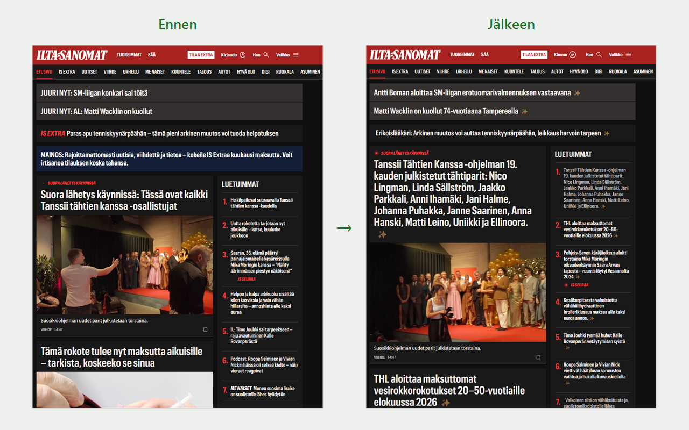

# 💀 Klikintappaja

[](https://github.com/kimvais/klikintappaja/releases/latest)
[](https://github.com/kimvais/klikintappaja/actions/workflows/build.yml)
[](https://chromewebstore.google.com/detail/jcdabpknfbcbcdbipfclhknoglhgecjl)
[](extension/manifest.json)
[](LICENSE)

<!-- Add these once the listing has actual installs/ratings — until then both
     shields endpoints resolve to a red "not found":
[](https://chromewebstore.google.com/detail/jcdabpknfbcbcdbipfclhknoglhgecjl)
[](https://chromewebstore.google.com/detail/jcdabpknfbcbcdbipfclhknoglhgecjl)
-->


A Chrome extension that replaces clickbait headlines on Finnish news sites
(**Ilta-Sanomat**, **Iltalehti**, and their cross-linked articles) with concise,
factual ones generated by an AI model — using **your own** API key.



As each headline scrolls into view, the extension fetches the linked article,
extracts its text, and asks your chosen AI provider to write a factual headline
from the **actual content** (never guessing from the clickbait title). A spinning
💀 marks work in progress; a subtle ✨ marks a killed clickbait. Results are
cached for 24h per article, and regenerated when the article itself is edited —
so a developing story gets a fresh headline rather than a stale one.

By default the original clickbait stays visible in a smaller line under the new
headline, and native-ad / "kaupallinen yhteistyö" (sponsored content) teasers
are hidden from the front page. Both are configurable in the popup.

Fully client-side: no backend, no analytics. The only data that leaves your
browser is the article text sent to the AI provider you selected.

## Install

**[➜ Get it from the Chrome Web Store](https://chromewebstore.google.com/detail/jcdabpknfbcbcdbipfclhknoglhgecjl)**
— also the way to install it in Brave, Vivaldi and other Chromium browsers,
which have no separate store.

Then open the popup, choose a provider, paste your API key, **Tallenna** (Save).

### Install unpacked (development, or to run the newest code)

The store version can lag behind `main`. To run the latest:

1. Download
   **[`klikintappaja-extension.zip`](https://github.com/kimvais/klikintappaja/releases/latest/download/klikintappaja-extension.zip)**
   (always the latest release) and unzip it — or run `pwsh ./build.ps1` and use
   the zip it produces, or point Chrome straight at the `extension/` folder.
2. `chrome://extensions` → enable **Developer mode** → **Load unpacked** → pick
   the folder containing `manifest.json`.
3. Open the popup, choose a provider, paste your API key, **Tallenna** (Save).

### Providers (bring your own key)

| Provider | Get a key | Default model |
| --- | --- | --- |
| Google Gemini | https://aistudio.google.com/apikey | `gemini-3.5-flash` |
| Anthropic Claude | https://console.anthropic.com | `claude-haiku-4-5` |
| OpenAI ChatGPT | https://platform.openai.com/api-keys | `gpt-4o-mini` |

Keys are stored per-provider in `chrome.storage.local` and never leave the
browser except in the request to the provider you chose.

## Build

```
pwsh ./build.ps1      # → klikintappaja-extension.zip (contents of extension/)
```

CI (`.github/workflows/build.yml`) validates and builds on every change; tagging
`v<version>` (matching `extension/manifest.json`) cuts a GitHub Release and can
auto-publish to the Chrome Web Store — see [PUBLISHING.md](PUBLISHING.md).

## Layout

| Path | What |
| --- | --- |
| `extension/` | the extension itself (loaded/zipped) |
| `store/` | Chrome Web Store listing assets (icon, screenshot, promo tiles) |
| `build.ps1` | build the distributable zip |
| `PUBLISHING.md` | release + Web Store publishing guide |
| `LICENSE` | MIT (mirrored into `extension/` so it ships in the zip) |

## Privacy

See [extension/PRIVACY.md](extension/PRIVACY.md).

## License

[MIT](LICENSE) © 2026 Kimmo Parviainen-Jalanko.

## Credits

The anti-clickbait prompt and the per-site article extractors originate in the
[`uutis`](https://github.com/) news-clustering project and were ported to
JavaScript for this extension.
